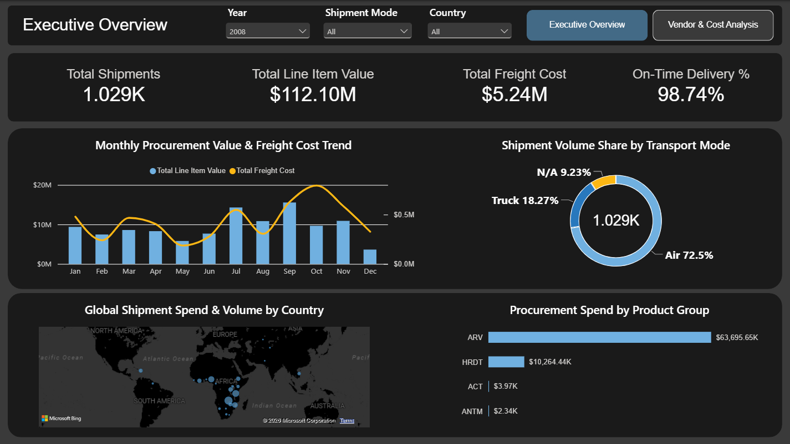
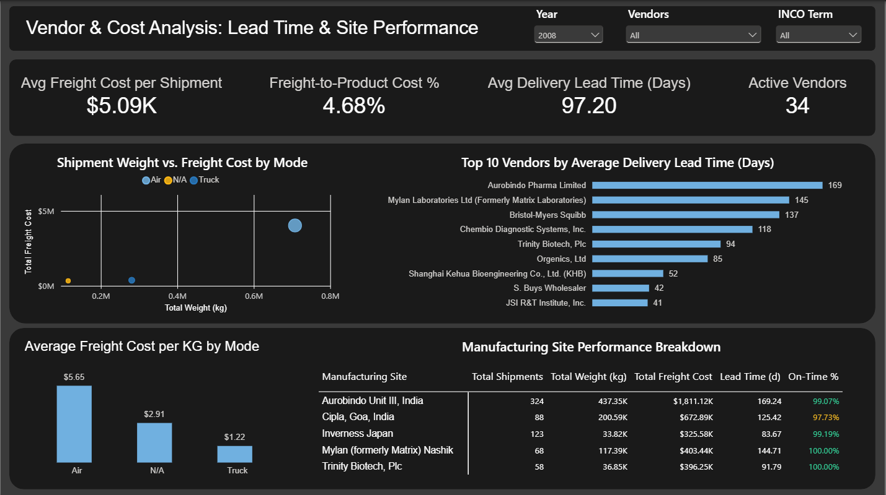

# SCMS Supply Chain & Shipment Pricing Dashboard

An interactive two-page dark-mode Power BI report analyzing Supply Chain Management System (SCMS) procurement spend, freight costs, shipping modes, delivery lead times, and vendor/manufacturing site performance.

## Dashboard Preview

### Page 1: Executive Overview

### Page 2: Vendor & Cost Analysis

## Key Pages & Visuals

### 1. Executive Overview
- **Executive KPI Cards:** `Total Shipments` (`1.029K`), `Total Line Item Value` (`$112.10M`), `Total Freight Cost` (`$5.24M`), and `On-Time Delivery %` (`98.74%`).
- **Monthly Procurement Value & Freight Cost Trend:** Monthly combo trend comparing line item value and freight cost across the selected period.
- **Shipment Volume Share by Transport Mode:** Donut chart breaking down shipment share across `Air` (`72.5%`), `Truck` (`18.27%`), and `N/A` (`9.23%`).
- **Global Shipment Spend & Volume by Country:** Map visual highlighting geographic shipment distribution and spend.
- **Procurement Spend by Product Group:** Horizontal bar breakdown across `ARV`, `HRDT`, `ACT`, and `ANTM` in thousands (`$K`).
- **Page Slicers:** `Year`, `Shipment Mode`, and `Country`.

### 2. Vendor & Cost Analysis
- **Operational Cost KPI Cards:** `Avg Freight Cost per Shipment` (`$5.09K`), `Freight-to-Product Cost %` (`4.68%`), `Avg Delivery Lead Time (Days)` (`97.20`), and `Active Vendors` (`34`).
- **Shipment Weight vs. Freight Cost by Mode:** Scatter plot evaluating shipment weight (`kg`) against total freight cost by transport mode.
- **Top 10 Vendors by Average Delivery Lead Time (Days):** Ranked horizontal bar chart of the top 10 vendors by shipment volume using standardized `Vendor Clean` names.
- **Average Freight Cost per KG by Mode:** Column chart comparing unit freight cost (`$/KG`) across transport modes (`Air`, `N/A`, `Truck`).
- **Manufacturing Site Performance Breakdown:** Matrix comparing `Total Shipments`, `Total Weight (kg)`, `Total Freight Cost`, `Lead Time (d)`, and `On-Time %` across manufacturing sites.
- **Page Slicers:** `Year`, `Vendors`, and `INCO Term`.

## Data Hygiene & Modeling Notes
- **Vendor Standardization (`Vendor Clean`):** Created a custom column in Power Query to normalize capitalization, resolve acronyms (`JSI R&T`, `KHB`, `MSD`, `SCMS`, `RDC`, `IDA`), and fix source spelling typos across 73 distinct raw vendor entries.
- **Preserving `N/A` in Shipment Mode:** Kept `N/A` (`9.23%` volume share) rather than deleting rows so aggregate shipment counts, product spend, and freight totals remain reconciled with the source dataset.
- **Lead Time & Visual Polish:** Filtered out anomalous negative lead times in measures, standardized white `Outside end` data labels on the Top 10 vendor lead-time chart, and configured clear active/inactive page navigation button states.

## Repository Structure
- `SCMS_Supply_Chain_Shipment_Pricing.pbix` — Power BI Desktop report and data model.
- `images/01_executive_overview.png` — Screenshot of the Executive Overview page.
- `images/02_vendor_cost_analysis.png` — Screenshot of the Vendor & Cost Analysis page.
- `README.md` — Project documentation and overview.
